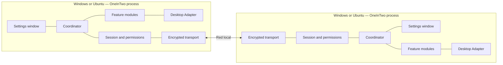

# OneInTwo — Proposed initial architecture

Initial design: November 4, 2026. Revision: November 13, 2026. Documentary version: 0.4.

This document develops the [preliminary study](PRELIMINARY_STUDY.md) and proposes the architecture of the integrated application. `src/` contains responsibilities and the first contracts declared in C++. The root CMake remains a documentary reserve. In parallel, `experiments/` It already contains three prototypes with code, independent compilation, manuals and reports. Its implementations do not yet constitute integrated modules of the product.

## 1. Decisions on this proposal

| Aspecto | Propuesta | Estado |
| --- | --- | --- |
| Product unit | A desktop app installed on each computer | Design Base |
| Implementation | One process per user session, with agent and configuration window | Design Base |
| Organization | Common core, functional modules and desktop adapters | Design Base |
| Initial platforms | Windows and Ubuntu; research Wayland in Ubuntu | Entornos/versiones outstanding |
| Lenguaje | C++ as the basis of the product; C++17 in prototypes | Final decision of the reviewable product |
| Graphical interface | General Library; Qt is the study candidate | Not selected or incorporated |
| Red | Own protocol on standard encrypted transport | Prototypes with OpenSSL and independent protocols; pending product protocol |
| Persistencia | User files and protection of secrets through appropriate system mechanisms | Pending formats |
| Own code | Product logic and original adapters, without engines of other applications | Requirement confirmed |
| Dependencies and leave | SDK/bibliotecas generals identified; project license to be chosen | Scope of units to be confirmed |

The provisional choice of C++ allows file names to materialize without forcing the graphic library
to be selected now. If the language changes, responsibilities and limits will be retained, adapting
the extensions and tools.

The initial objective comprises two devices, a physical origin of keyboard and mouse selected, a
monitor per equipment and unlocked sessions. They are assumptions of the study, no restrictions
already approved by the user. The code should be able to reverse which equipment acts as origin.

## 2. Execution view

On each computer there will be a process that keeps the connection and active modules. The
configuration window opens and closes within that process. Close the window leaves the agent
running; the explicit action "Out" starts the disconnection and release of resources.

A second opening of the application should activate the existing window. Only the local mechanism of
single instance and activation that offers the chosen solution is needed; a public administration
API is not proposed nor is it proposed to separate interface and agent in different processes.



The capture and reproduction of input occur in the graphical session of the user. A privileged
system service is not needed to justify this architecture. If future capacity requires it, it should
be studied independently.

## 3. Components and ownership of decisions

| Componente | Responsabilidad | State of ownership |
| --- | --- | --- |
| Input of executable | Start and deliver to the coordinator | Boot Options |
| Coordinator | Construction, connections between components and shutdown | Life cycle of the application |
| Meeting | Linking, Capabilities, Permits and Authorized Dispatch | Identity of the pair, generation, effective permits |
| Descubrimiento | Locate candidates and manage addresses | Announcements and temporary candidates |
| Transporte | Encrypted connections, queues, limits and errors of E/S | Lined channels and buffers |
| Protocolo | Structural representation and validation of messages | Parser and messages in progress |
| Clipboard | Text synchronization and echo prevention | Last valid operation and logical order |
| Files | Offers from clipboard or window, transfers, integrity and publication | Authorized, temporary and progress files |
| Entrada | Change of destination, sequence and recovery | Remote focus and active keys/buttons |
| Enlaces | Sending and local confirmation of a URL | Outstanding offer and its expiry |
| Visual | Share a monitor or window and coordinate your viewer | Invitation, source and live operation |
| Notificaciones | Send, filter and submit manual or forward notices | Local observation, pending notices and deduplication |
| Perfiles | Define the capabilities that each profile allows | Capacity set by profile |
| Desktop | Native operations and system permissions | Native resources and observed capabilities |
| Almacenamiento | Persistent preferences and confidence | Saved state, never active authorization alone |
| Interfaz | User Settings, Status, and Actions | Presentation; without parallel status of authorisation |

### Dependency rules

- The coordinator builds components and connects llamadas/eventos explicit.
- The interface sends actions to the coordinator and receives a state view. It does not open sockets
  or inject keys.
- The session validates identity, generation, capacity and permission before delivering an operation
  to the module.
- Each module also applies its limits: for example, files check that the requested identifier
  belongs to a current offer.
- The modules access the desktop under the common contract. They do not include Windows or D-Bus
  structures in their rules.
- Adapters report standardized events; they do not know the network protocol or decide the trust
  between teams.
- Storage saves data, but a saved preference does not amount to a valid desktop permission.

Connections between session and modules will be fixed in the coordinator. No need for a container of
dependencies, a general event bus, dynamic plugins or a process per module. The separations created
correspond to real differences of platform or status.

## 4. Key contracts

### 4.1 Session and messages

Each message must include type, applicable version, length and necessary session or operation
identification. The field detail and encoding will be defined before the first compatible exchange.

Planned families:

| Familia | Uso |
| --- | --- |
| Establecimiento | Compatibility, identity, linkage and negotiation of capabilities |
| Session Control | Permissions, closing, connection checking and errors |
| Clipboard | Offer or update of text and origin identification |
| Files | Offer with delivery mode, acceptance, request for content, blocks, termination and cancellation |
| Enlaces | Offer of URL with ID and session generation |
| Entrada | Preparation of destination, activation, events, release and return |
| Visual | Invitation, decision, source status, activity and closure via the interactive channel. Video via the data channel. |
| Notificaciones | Manual and forwarded warnings, limited by modality, through the interactive channel. |

The data received pass through these checks: limit of bytes → valid format → authorized channel and session
→ functional permission → module specific validation.

An unknown connection will only be able to participate in the limited linkage flow. It will not have
access to the modules. The initial identity check mechanism must be selected between revised
solutions; this design does not invent a cryptographic exchange.

### 4.2 Desktop Contract

`src/platform/desktop.hpp` contains the first visual capture contracts and notifications. The
desktop distinguishes these operations:

- Observe and publish text.
- Interpret a copy of files and offer files to the local browser.
- Capture devices at source.
- Inject entry into destination.
- Get screen geometry and receive changes.
- Observe blocking, closing and withdrawal of permits.
- Request local opening of a URL validated when confirmed by the recipient.
- Select and capture a single local visual source of the requested type and report suspension or
  closure.
- Submit your own notices and, when the desktop allows, observe notices from other applications.

Operations will return success or explicit status: pending authorization, denied, unavailable or
error. Those that need user interaction or access to content will be asynchronous and can be
cancelled.

The effective capability results from combining observed local support, announced remote support and
permissions from both sides. The receiver will continue to check their permissions: a remote ad does
not replace them.

### 4.3 Single owner of clipboard

The clipboard adapter of each platform observes and publishes native content. It classifies formats
and uses the file adapter when applicable. The coordinator directs the event to the text or file
module.

This prevents both modules from publishing on their own and being accidentally replaced. A file
offer can provide several native representations, but it continues to have a single owner and a
coordinated life cycle.

## 5. Main flows

### 5.1 Link and reconnect

1. Discovery or manual direction provides a candidate.
2. Transportation establishes the channel and delivers the necessary identity information.
3. Session coordinates initial verification with interface and confirmation on both teams.
4. Upon completion of the link, storage retains the chosen identity and permissions.
5. Session negotiates capabilities and enables only authorized operations.
6. A reconnection checks the saved identity and creates a new generation; it does not restore
   pending keys or automatically send the previous clipboard.

The case of both teams connecting at the same time must be resolved, maintaining a single logical
session.

### 5.2 Copy and paste text

1. The adapter detects a local copy and delivers the supported content.
2. The module discards notifications caused by their own scripts.
3. Assign identity and logical order to the operation and request its submission to the session.
4. The receiver validates and applies the update via its adapter.
5. The notification produced by that deed is recognized to prevent echo.

Proposal for attendance: Logical counter that advances with local and received events, with stable
tiebreaker by team identity. It is independent of wall time. It must be combined with session
generation and an explicit reconnection policy.

The content will remain transient; it will not store its own history. Share clipboard with inactive
input capture is still pending from the P2 test.

### 5.3 Copy and paste files

1. The adapter recognizes the copied selection; files creates an offer with opaque identifiers and
   narrowed metadata.
2. The recipient accepts the offer under their permissions and prepares their representation in the
   browser.
3. According to the result of P3, the adapter provides content on demand or publishes files prepared
   in a local cache.
4. Files moves content by blocks, validates destination and integrity and manages time.
5. The adapter reports availability or error to the browser without blocking interactive processing.
6. Files retains resources while in use and cleans those that no longer have references.

The network carries validated offer identifiers and relative routes. It never accepts a request for
arbitrary reading of the route provided by the other computer.

A replaced offer ceases to accept new requests. An already accepted transfer must maintain an
explicit reference or be cancelled according to the chosen policy. Changing session or revoke
permissions invalidates the affected operations.

The glue detail — cached to provider — focuses on collaboration between `files.cpp` and
`file_clipboard.cpp`, preserving file transport. A virtual file system is not now introduced.

### 5.4 Cross the other computer and return

1. The input module configures layout and edges with the adapter.
2. When the desktop activates the capture, the module checks that the destination is still ready and
   authorized. If it is not, it releases the capture.
3. The transition agrees to a control generation and a valid destination before sending events.
4. During remote control, source and receiver maintain sequences and status of teclas/botones.
5. When you reach the return border or activate local recovery, the remote state is released and the
   control is returned to the source.
6. If the connection fails, each end is recovered by its own state and timer.

The remote desktop output position, coordinate correspondence and cursor return require P1. The
design does not assume that the global cursor can always be observed or captured at any time.

## 6. States, competition and judgements

### Separate States

| Estado | Main transitions |
| --- | --- |
| Network session | Disconnected → establishing → linking/authenticating → preparing → closing |
| Input Control | Local → transition → remote → recovery → local |
| Transfer | Offered → accepted → transferring → verifying → completed; cancellation or error from active states |
| Desktop capacity | Not available / permission pending / available / revoked |
| Visual | Selection → invitation → acceptance → live → closing. The suspension of the source emptys the viewer. |
| Warnings | Queue → sent or submitted. Expiry and revocation rule out pending. |

Close the main window retains the network session. Close a viewer ends its visual operation. Disable
entry does not cancel a transfer by itself. Session loss does invalidate control and operations
linked to that generation.

### Initial Concurrence

The interface, desktop notifications, and coordinator transitions must respect the threads required
by the chosen library and native APIs. Network and disk tasks will not be executed in capture
callbacks or block the IU.

It is proposed E/S asynchronous for network and a limited number of file jobs. No thread is assigned
per file or event. The results return to the owner of the state with operating identifiers, so that
a late result does not reactivate a cancelled operation.

Adapters may need specific native threads. Their details will be internal and documented when
deploying, particularly for browser message and object loops.

### Network channels

A reliable interactive channel is proposed for control, input and warnings, and a reliable data
channel for files and video. File blocks and video fragments are interspersed with narrow queues.
Both encryptions, associated with the same identity and generation, with maximum sizes, narrow
queues and cancellation.

A secondary channel that arrives before being authorized will be refused. Separation does not
prevent physical saturation of the network; the transfer module must support flow control. It is not
assumed that TCP alone guarantees objective latency.

### Recovery and closure

The input receiver will have a separate timer to release keys if the sender disappears. The source
will retain a local capture output that does not depend on receiving a remote response.

The shutdown will follow this logical order: prevent new operations → recover input and release
states → cancel transfers and video → withdraw native offers and notices → close channels and
desktop sessions → save valid preferences and release resources. File cleaning will not eliminate
resources still consumed by the browser.

## 7. Adaptations by operating system

### Windows

The Windows directory groups session context, clipboard ownership, integration with Explorer and
native input. Each file concentrates the life of its resources and its thread affinity.

The candidate pathways are those described in the study: clipboard notifications, archivo/OLE
formats, input hooks and `SendInput`. Integrity restrictions prevent a normal process from assuming
that any elevated window can be controlled.
[SendInput](https://learn.microsoft.com/en-us/windows/win32/api/winuser/nf-winuser-sendinput).

### Ubuntu / Wayland

`portal_session.cpp` concentrates the authorization and shared life cycle of the portals; the input
adapters and clipboards consume those sessions. This is necessary because the clipboard portal
expands sessions of other portals and, with InputCapture, its availability depends on active
capture. [Portal
Clipboard](https://flatpak.github.io/xdg-desktop-portal/docs/doc-org.freedesktop.portal.Clipboard.html).

The activation of capture through barriers is controlled by the composer. The adapter must reflect its states and zone changes, not translate an application request into a supposed success. [Portal InputCapture](https://flatpak.github.io/xdg-desktop-portal/docs/doc-org.freedesktop.portal.InputCapture.html).

These limits are reflected in the capacity contract. Clipboards and input are independent functions
for the user, even if they can share technical resources. Activate clipboard does not grant
functional remote control permission.

The input experiment already includes a X11 backend and a Wayland; the clipboard experiment
implements Wayland without failback X11. There is no integrated product backend yet: incorporating
or expanding the X11 support requires a specific scope and validation decision.

## 8. Persistence and user data

The configuration will be saved outside the repository, in user- and system-specific locations.
Definitive paths depend on the selected libraries.

| Dato | Tratamiento |
| --- | --- |
| Preferences and layout | Persisting and versioned, including the local profile of each pair |
| Related identities and permits | Persistent, validated when loading |
| Private keys | System-specific protection; legible preferences separated |
| Clipboards, input, links, video and notifications | Transitional content without own history or content record |
| Notifications forwarded | Persistent local list of authorised applications |
| Incomplete Files | Private time, quota and cleaning documented |
| Diagnosis | Events and errors without secrets, keystrokes or clipboard content |

For two computers a database server is not now justified. The persistent format will be chosen when
implementing and will have secure writing and defined behavior in the face of corruption. Resumption
of transfers between restarts is an extension, not an implicit property of storage.

## 9. Product structure and location of prototypes

```text
OneInTwo/
├── README.md
├── PRELIMINARY_STUDY.md
├── ARCHITECTURE.md
├── FEATURES.md
├── docs/
│   ├── SHARE_SCREEN.md
│   ├── SHARE_WINDOW.md
│   └── NOTIFICATIONS.md
├── AGENTS.md
├── TODO.md
├── CMakeLists.txt
├── .gitignore
├── src/
│   ├── main.cpp
│   ├── app/
│   │   └── application.cpp
│   ├── core/
│   │   ├── session.cpp
│   │   └── session.hpp
│   ├── net/
│   │   ├── discovery.cpp
│   │   ├── transport.cpp
│   │   ├── protocol.hpp
│   │   └── protocol.cpp
│   ├── features/
│   │   ├── clipboard.cpp
│   │   ├── files.cpp
│   │   ├── files.hpp
│   │   ├── input.cpp
│   │   ├── links.cpp
│   │   ├── links.hpp
│   │   ├── notifications.cpp
│   │   ├── notifications.hpp
│   │   ├── profiles.cpp
│   │   ├── profiles.hpp
│   │   ├── visual_share.cpp
│   │   └── visual_share.hpp
│   ├── platform/
│   │   ├── desktop.hpp
│   │   ├── windows/
│   │   │   ├── desktop.cpp
│   │   │   ├── clipboard.cpp
│   │   │   ├── file_clipboard.cpp
│   │   │   ├── input.cpp
│   │   │   ├── notifications.cpp
│   │   │   └── visual_capture.cpp
│   │   └── linux/
│   │       ├── desktop.cpp
│   │       ├── portal_session.cpp
│   │       ├── clipboard.cpp
│   │       ├── file_clipboard.cpp
│   │       ├── input.cpp
│   │       ├── notifications.cpp
│   │       └── visual_capture.cpp
│   ├── storage/
│   │   └── local_store.cpp
│   └── ui/
│       ├── main_window.cpp
│       └── visual_viewer.cpp
├── tests/
│   └── README.md
├── experiments/
│   ├── README.md
│   ├── AGENTS.md
│   ├── clipboard/    # code, CMake, tests, README, MANUAL, and RESULTS
│   ├── files/        # code, CMake, tests, README, MANUAL, and RESULTS
│   └── input/        # code, CMake, tests, README, MANUAL, and RESULTS
└── packaging/
    ├── windows/
    │   └── README.md
    └── ubuntu/
        └── README.md
```

The `.cpp` and `.hpp` of `src/` of the product contain descriptions of responsibilities and design
declarations. Prototypes under `experiments/` do contain implementations and tests. The tree
summarizes its location; each README experimental details its files. Final contracts of the
application will be specified with the results of feasibility.

`CMakeLists.txt` is a commented reservation for future compilation, without project or objectives. A
CMake configuration should not be presented as a compilation test. `.gitignore` excludes proposed
private development outlets and locations; it does not configure production routes.

`tests/` specifies future product verifications and `packaging/` describes pending installers.
`experiments/` contains prototype operating code, isolated tests and evidence of explicit scope,
with manual desktop and pending network validation.

## 10. Implementation and verification order

1. Record environment and perform P1–P3 experiments, with P4 for recovery. Decide real capabilities
   and file delivery.
2. Confirm language, graphic library, secure transport and dependencies policy. Convert the build
   reserve to a minimum tested executable.
3. Implement desktop context, coordinator, configuration, and diagnostic capabilities.
4. Implement session, link and protocol with error testing, permissions and reconnection.
5. Integrate clipboard and input, including attendance, return and recovery.
6. Implement transfers and their actual integration with both browsers.
7. Check simultaneous use, installation and platforms before publishing.

The first core tests can be run without a desktop. Integration tests must check the APIs and the
actual browsers. The [test plan](tests/README.md) specifies the scenarios; the
[experiments](experiments/README.md) will record which decisions they unlock.

Steps 1 and 2 already have experimental work done: you do not need to re-create the prototypes. You
need to complete your pending compilations, run manual validation and decide on reuse before
building the built-in executable.

## 11. Decisions that may change the structure

- ** Independent clipboard in Wayland:** could require another desktop integration. It will be
  incorporated only if the experiment justifies it.
- **Stuck on demand:** you could add a local specialized provider. The transfer module will remain
  the owner of authorization and integrity.
- **X11 and multiple monitors:** will expand adapters and tests, without multiplying applications.
- **Separation of processes:** only if isolation, reliability or native restrictions make it
  necessary; it would involve designing local communication and its authorization.
- **Dependent choice:** can change implementation and packaging; does not convert third-party
  libraries into own code.
- ** License:** to be selected before publication, with inventory of units finally used.

The responsibility of this document is to maintain the global view and justify the limits. By
changing a decision, your effects and descriptions of the affected files will be updated here. This
version does not declare verified functionalities.

## 12. Experimental evidence and integration decisions

- [Paper clipboard](experiments/clipboard/RESULTS.md): Windows and Wayland/TLS compiled. Local
  reading, pasting, observation and cancellation Ubuntu verified with zero input devices.
  Synchronization between computers is still pending.
- [Entry](experiments/input/RESULTS.md): Windows and Wayland/TLS compiled. Ubuntu verified
  injection, shortcut and withdrawal of permissions with a monitor; it retains the historical
  freezing incident and its limits. The Ubuntu origin is blocked by InputCapture v1 against the v2
  requirement. Crossing and recovery between pending equipment; X11 without new validation.
- [Archives](experiments/files/RESULTS.md): Windows and Ubuntu/GTK/TLS compiled. Cache, glued
  assisted in Nautilus and local TLS tests have evidence. Wayland automatic publishing and Linux
  delivery on demand remain limited; Explorer and transfers between computers are pending.

The three prototypes maintain separate transports, protocols and dependencies so as not to block
their development. They should not be linked together as if they shared a compatible protocol.
Future integration will choose a product connection and coordinate a single owner of the clipboard,
preserving the above responsibilities.

The choices of libdbus in clipboard and GDBus/libei in entry belong to the prototypes; they do not
fix two parallel implementations of sessions in the product. The architectural review after the
tests will decide what is conserved. The updated state is centralized at
[experiments/README.md](experiments/README.md) and the [pending](TODO.md).

## 13. Additional functions

The [design of additional functions](FEATURES.md) defines the direct sending of files, the
sending of links and the profiles of use. The direct sending and pasting share the file module and
the data channel, with permissions for each modality. Links travel as offers through the interactive
channel. The profiles limit the effective capabilities from the session and reuse the exchange of
permissions. The C++ contracts leave the entries of each module foreseen. Their implementation
starts with the common session of the product.

| Design | Product integration |
| --- | --- |
| [Share screen](docs/SHARE_SCREEN.md) | The coordinator connects [local capture](src/platform/desktop.hpp), [visual module](src/features/visual_share.hpp) and [visor](src/ui/visual_viewer.cpp). The permit authorizes the monitor mode only. |
| [Share a window](docs/SHARE_WINDOW.md) | Use the same visual module with a native window source and own permission. Viewfinder and transport are common. |
| [Notificaciones](docs/NOTIFICATIONS.md) | The coordinator connects the [ads module](src/features/notifications.hpp) with the native form and adapter. Manual shipping and observation of other applications have separate permissions. |

To implement the video, first check the two source types on each desktop and validate the local
cycle of the viewer. Then integrate invitation, cancellation and video into the product session. For
warnings, start with manual shipping and presentation on both computers. Automatic observation
depends on the adapter and your local authorization.


## 14. Coordination of the implementation of video and announcements

The [parallel implementation base](docs/PARALLEL_IMPLEMENTATION.md) assigns three branches with disjoint file ownership and fixes signatures, factories, dependencies, message format, limits and tests. It is the compatibility reference for this delivery.

The [common C++ contract](src/integration/feature_contracts.hpp) connects modules with capture,
viewfinder, notifications, clock and session. Private implementations are in charge of each branch.
The integrator retains ownership of shared headers and gathers all three deliveries.
