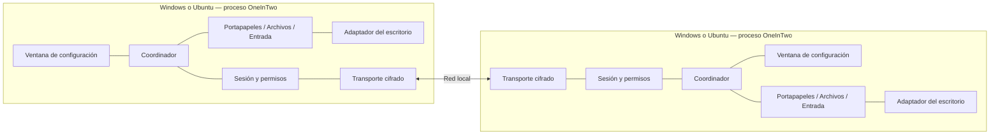

# OneInTwo — Arquitectura inicial propuesta

Diseño inicial: 4 de noviembre de 2026. Revisión: 5 de noviembre de 2026. Versión documental: 0.2.

Este documento desarrolla el [estudio preliminar](ESTUDIO_PRELIMINAR.md) y propone la arquitectura de la aplicación integrada. Su `src/` y CMake raíz siguen siendo una estructura documental. En paralelo, `experiments/` ya contiene tres prototipos con código, compilación independiente, manuales e informes. Sus implementaciones no constituyen todavía módulos integrados del producto.

## 1. Decisiones de esta propuesta

| Aspecto | Propuesta | Estado |
| --- | --- | --- |
| Unidad de producto | Una aplicación de escritorio instalada en cada equipo | Base de diseño |
| Ejecución | Un proceso por sesión de usuario, con agente y ventana de configuración | Base de diseño |
| Organización | Núcleo común, módulos funcionales y adaptadores del escritorio | Base de diseño |
| Plataformas iniciales | Windows y Ubuntu; investigar Wayland en Ubuntu | Entornos/versiones pendientes |
| Lenguaje | C++ como base del producto; C++17 en los prototipos | Decisión final del producto revisable |
| Interfaz gráfica | Biblioteca general; Qt es el candidato del estudio | Sin seleccionar ni incorporar |
| Red | Protocolo propio sobre transporte cifrado estándar | Prototipos con OpenSSL y protocolos independientes; protocolo de producto pendiente |
| Persistencia | Archivos de usuario y protección de secretos mediante mecanismos adecuados del sistema | Formatos pendientes |
| Código propio | Lógica del producto y adaptadores originales, sin motores de otras aplicaciones | Requisito confirmado |
| Dependencias y licencia | SDK/bibliotecas generales identificadas; licencia del proyecto por elegir | Alcance de dependencias pendiente de confirmar |

La elección provisional de C++ permite materializar nombres de archivos sin obligar a seleccionar ahora la biblioteca gráfica. Si cambia el lenguaje, se conservarán responsabilidades y límites, adaptando las extensiones y herramientas.

El objetivo inicial comprende dos equipos, un origen físico de teclado/ratón seleccionado, un monitor por equipo y sesiones desbloqueadas. Son supuestos del estudio, no restricciones ya aprobadas por el usuario. El código debe poder invertir qué equipo actúa como origen.

## 2. Vista de ejecución

En cada ordenador habrá un proceso que conserva la conexión y los módulos activos. La ventana de configuración se abre y cierra dentro de ese proceso. Cerrar la ventana deja el agente funcionando; la acción explícita «Salir» inicia la desconexión y liberación de recursos.

Una segunda apertura de la aplicación deberá activar la ventana existente. Solo se necesita el mecanismo local de instancia única y activación que ofrezca la solución elegida; no se propone una API pública de administración ni separar interfaz y agente en procesos diferentes.



La captura y reproducción de entrada ocurren en la sesión gráfica del usuario. No se necesita un servicio privilegiado de sistema para justificar esta arquitectura. Si una capacidad futura lo exigiera, deberá estudiarse de manera independiente.

## 3. Componentes y propiedad de las decisiones

| Componente | Responsabilidad | Estado del que es propietario |
| --- | --- | --- |
| Entrada del ejecutable | Arranque y entrega al coordinador | Opciones de arranque |
| Coordinador | Construcción, conexiones entre componentes y apagado | Ciclo de vida de la aplicación |
| Sesión | Vinculación, capacidades, permisos y despacho autorizado | Identidad del par, generación, permisos efectivos |
| Descubrimiento | Localizar candidatos y gestionar direcciones | Anuncios y candidatos temporales |
| Transporte | Conexiones cifradas, colas, límites y errores de E/S | Canales y buffers acotados |
| Protocolo | Representación y validación estructural de mensajes | Parser y mensajes en curso |
| Portapapeles | Sincronización de texto y prevención de eco | Última operación válida y orden lógico |
| Archivos | Ofertas, transferencias, integridad y publicación | Archivos autorizados, temporales y progreso |
| Entrada | Cambio de destino, secuencia y recuperación | Foco remoto y teclas/botones activos |
| Escritorio | Operaciones nativas y permisos del sistema | Recursos nativos y capacidades observadas |
| Almacenamiento | Preferencias y confianza persistente | Estado guardado, nunca la autorización activa por sí solo |
| Interfaz | Configuración, estado y acciones del usuario | Presentación; sin estado paralelo de autorización |

### Reglas de dependencia

- El coordinador construye componentes y conecta llamadas/eventos explícitos.
- La interfaz envía acciones al coordinador y recibe una vista del estado. No abre sockets ni inyecta teclas.
- La sesión valida identidad, generación, capacidad y permiso antes de entregar una operación al módulo.
- Cada módulo aplica además sus límites: por ejemplo, archivos comprueba que el identificador solicitado pertenece a una oferta vigente.
- Los módulos acceden al escritorio por el contrato común. No incluyen estructuras de Windows o D-Bus en sus reglas.
- Los adaptadores notifican eventos normalizados; no conocen el protocolo de red ni deciden la confianza entre equipos.
- El almacenamiento guarda datos, pero una preferencia guardada no equivale a un permiso vigente del escritorio.

Las conexiones entre sesión y módulos se fijarán en el coordinador. No se necesita un contenedor de dependencias, un bus de eventos general, plugins dinámicos ni un proceso por módulo. Las separaciones creadas corresponden a diferencias reales de plataforma o de estado.

## 4. Contratos fundamentales

### 4.1 Sesión y mensajes

Cada mensaje deberá incluir tipo, versión aplicable, longitud y la identificación necesaria de sesión u operación. El detalle de campos y codificación se definirá antes del primer intercambio compatible.

Familias previstas:

| Familia | Uso |
| --- | --- |
| Establecimiento | Compatibilidad, identidad, vinculación y negociación de capacidades |
| Control de sesión | Permisos, cierre, comprobación de conexión y errores |
| Portapapeles | Oferta o actualización de texto e identificación de origen |
| Archivos | Oferta, aceptación, petición de contenido, bloques, finalización y cancelación |
| Entrada | Preparación del destino, activación, eventos, liberación y retorno |

Los datos recibidos atraviesan estas comprobaciones: límite de bytes → formato válido → canal/sesión autorizados → permiso funcional → validación específica del módulo.

Una conexión desconocida solo podrá participar en el flujo limitado de vinculación. No tendrá acceso a los módulos. El mecanismo de comprobación inicial de identidad debe seleccionarse entre soluciones revisadas; este diseño no inventa un intercambio criptográfico.

### 4.2 Contrato del escritorio

`src/platform/desktop.hpp` delimita capacidades y operaciones, todavía sin firmas de C++ definitivas. Debe distinguir, al menos:

- Observar y publicar texto.
- Interpretar una copia de archivos y ofrecer archivos al explorador local.
- Capturar dispositivos en origen.
- Inyectar entrada en destino.
- Obtener geometría de pantallas y recibir cambios.
- Observar bloqueo, cierre y retirada de permisos.

Las operaciones devolverán éxito o un estado explícito: pendiente de autorización, denegado, no disponible o error. Las que necesiten interacción con el usuario o acceso al contenido serán asíncronas y cancelables.

La capacidad efectiva resulta de combinar soporte local observado, soporte remoto anunciado y permisos de ambos lados. El receptor seguirá comprobando sus permisos: un anuncio remoto no los sustituye.

### 4.3 Un solo propietario del portapapeles

El adaptador de portapapeles de cada plataforma observa y publica el contenido nativo. Clasifica los formatos y utiliza el adaptador de archivos cuando corresponda. El coordinador dirige el evento al módulo de texto o de archivos.

Así se evita que ambos módulos publiquen por su cuenta y se reemplacen accidentalmente. Una oferta de archivos puede proporcionar varias representaciones nativas, pero continúa teniendo un único dueño y un ciclo de vida coordinado.

## 5. Flujos principales

### 5.1 Vincular y reconectar

1. Descubrimiento o dirección manual aporta un candidato.
2. Transporte establece el canal y entrega la información de identidad necesaria.
3. Sesión coordina la verificación inicial con la interfaz y la confirmación en ambos equipos.
4. Al completarse la vinculación, almacenamiento conserva la identidad y permisos elegidos.
5. Sesión negocia capacidades y habilita únicamente operaciones autorizadas.
6. Una reconexión verifica la identidad guardada y crea una generación nueva; no restaura teclas pendientes ni envía automáticamente el portapapeles anterior.

Debe resolverse el caso de que ambos equipos se conecten a la vez, manteniendo una sola sesión lógica.

### 5.2 Copiar y pegar texto

1. El adaptador detecta una copia local y entrega el contenido admitido.
2. El módulo descarta notificaciones provocadas por sus propias escrituras.
3. Asigna identidad y orden lógico a la operación y solicita su envío a la sesión.
4. El receptor valida y aplica la actualización mediante su adaptador.
5. La notificación producida por esa escritura queda reconocida para impedir eco.

Propuesta para concurrencia: contador lógico que avance con eventos locales y recibidos, con desempate estable por identidad de equipo. Es independiente de la hora de pared. Debe combinarse con la generación de sesión y una política explícita de reconexión.

El contenido se mantendrá transitorio; no se almacenará un historial propio. Compartir portapapeles con la captura de entrada inactiva continúa pendiente de la prueba P2.

### 5.3 Copiar y pegar archivos

1. El adaptador reconoce la selección copiada; archivos crea una oferta con identificadores opacos y metadatos acotados.
2. El receptor acepta la oferta bajo sus permisos y prepara su representación en el explorador.
3. Según el resultado de P3, el adaptador facilita contenido bajo demanda o publica archivos preparados en una caché local.
4. Archivos mueve el contenido por bloques, valida destino e integridad y gestiona temporales.
5. El adaptador informa de disponibilidad o error al explorador sin bloquear el procesamiento interactivo.
6. Archivos conserva recursos mientras estén en uso y limpia los que ya no tengan referencias.

La red transporta identificadores de oferta y rutas relativas validadas. Nunca acepta una petición de lectura arbitraria de la ruta que el otro equipo proporcione.

Una oferta reemplazada deja de admitir nuevas solicitudes. Una transferencia ya aceptada deberá mantener una referencia explícita o cancelarse según la política elegida. Cambiar de sesión o revocar permisos invalida las operaciones afectadas.

El detalle de pegado —caché frente a proveedor— se concentra en la colaboración entre `files.cpp` y `file_clipboard.cpp`, preservando el transporte de archivos. No se introduce ahora un sistema de archivos virtual.

### 5.4 Cruzar al otro ordenador y regresar

1. El módulo de entrada configura disposición y bordes con el adaptador.
2. Cuando el escritorio active la captura, el módulo comprueba que el destino sigue preparado y autorizado. Si no lo está, libera la captura.
3. La transición acuerda una generación de control y un destino válido antes de enviar eventos.
4. Durante el control remoto, origen y receptor mantienen secuencias y estado de teclas/botones.
5. Al alcanzar el borde de retorno o activar la recuperación local, se libera el estado remoto y se devuelve el control al origen.
6. Si falla la conexión, cada extremo se recupera mediante su propio estado y temporizador.

La posición de salida del escritorio remoto, la correspondencia de coordenadas y el retorno del cursor requieren P1. El diseño no asume que siempre pueda observarse el cursor global o forzarse la captura en cualquier momento.

## 6. Estados, concurrencia y fallos

### Estados separados

| Estado | Transiciones principales |
| --- | --- |
| Sesión de red | Desconectada → estableciendo → vinculando/autenticando → preparada → cerrando |
| Control de entrada | Local → transición → remoto → recuperación → local |
| Transferencia | Ofrecida → aceptada → transfiriendo → verificando → completada; cancelación/error desde estados activos |
| Capacidad del escritorio | No disponible / pendiente de permiso / disponible / revocada |

Cerrar una ventana no cambia el estado de red. Desactivar entrada no cancela por sí solo una transferencia. La pérdida de sesión sí invalida el control y las operaciones vinculadas a esa generación.

### Concurrencia inicial

La interfaz, las notificaciones del escritorio y las transiciones del coordinador deben respetar los hilos requeridos por la biblioteca elegida y las APIs nativas. Las tareas de red y disco no se ejecutarán en callbacks de captura ni bloquearán la UI.

Se propone E/S asíncrona para red y un número acotado de trabajos de archivo. No se asigna un hilo por archivo o evento. Los resultados vuelven al propietario del estado con identificadores de operación, de modo que un resultado tardío no reactive una operación cancelada.

Los adaptadores podrán necesitar hilos nativos específicos. Sus detalles quedarán internos y documentados al implementar, en particular para bucles de mensajes y objetos del explorador.

### Canales de red

Propuesta inicial: canal interactivo fiable para control, entrada y anuncios pequeños, y canal de datos fiable separado para archivos y contenidos voluminosos. Ambos cifrados, asociados a la misma identidad y generación, con tamaños máximos, colas acotadas y cancelación.

Un canal secundario que llegue antes de estar autorizado se rechazará. La separación no evita la saturación física de la red; el módulo de transferencia debe admitir control de caudal. No se presupone que TCP por sí solo garantice la latencia objetivo.

### Recuperación y cierre

El receptor de entrada tendrá un temporizador independiente para liberar teclas si desaparece el emisor. El origen conservará una salida local de la captura que no dependa de recibir una respuesta remota.

El apagado seguirá este orden lógico: impedir nuevas operaciones → recuperar entrada y liberar estados → cancelar transferencias → retirar ofertas nativas → cerrar canales y sesiones del escritorio → guardar preferencias válidas y liberar recursos. La limpieza de archivos no eliminará recursos aún consumidos por el explorador.

## 7. Adaptaciones por sistema operativo

### Windows

El directorio Windows agrupa contexto de sesión, propiedad del portapapeles, integración con Explorer y entrada nativa. Cada archivo concentra la vida de sus recursos y su afinidad de hilo.

Las vías candidatas son las descritas en el estudio: notificaciones del portapapeles, formatos de archivo/OLE, hooks de entrada y `SendInput`. Las restricciones de integridad impiden asumir que un proceso normal pueda controlar cualquier ventana elevada. [SendInput](https://learn.microsoft.com/en-us/windows/win32/api/winuser/nf-winuser-sendinput).

### Ubuntu / Wayland

`portal_session.cpp` concentra la autorización y el ciclo de vida compartido de los portales; los adaptadores de entrada y portapapeles consumen esas sesiones. Esto es necesario porque el portal de portapapeles amplía sesiones de otros portales y, con InputCapture, su disponibilidad depende de la captura activa. [Portal Clipboard](https://flatpak.github.io/xdg-desktop-portal/docs/doc-org.freedesktop.portal.Clipboard.html).

La activación de captura mediante barreras está controlada por el compositor. El adaptador debe reflejar sus estados y cambios de zonas, no traducir una solicitud de la aplicación en un supuesto éxito. [Portal InputCapture](https://flatpak.github.io/xdg-desktop-portal/docs/doc-org.freedesktop.portal.InputCapture.html).

Estos límites se reflejan en el contrato de capacidades. Portapapeles y entrada son funciones independientes para el usuario, aunque puedan compartir recursos técnicos. Activar portapapeles no concede permiso funcional de control remoto.

El experimento de entrada ya incluye un backend X11 y uno Wayland; el de portapapeles implementa Wayland sin fallback X11. No hay todavía backend integrado de producto: incorporar o ampliar el soporte X11 requiere una decisión de alcance y validación específica.

## 8. Persistencia y datos de usuario

La configuración se guardará fuera del repositorio, en ubicaciones propias del usuario y sistema. Las rutas definitivas dependen de las bibliotecas elegidas.

| Dato | Tratamiento |
| --- | --- |
| Preferencias y disposición | Persistentes y versionadas |
| Identidades vinculadas y permisos | Persistentes, validadas al cargar |
| Claves privadas | Protección específica del sistema; separadas de preferencias legibles |
| Portapapeles y entrada | Transitorios; sin historial ni registro de contenido |
| Archivos incompletos | Temporales privados, cuota y limpieza documentadas |
| Diagnóstico | Eventos y errores sin secretos, pulsaciones ni contenido del portapapeles |

Para dos equipos no se justifica ahora un servidor de base de datos. El formato persistente se elegirá al implementar y tendrá escritura segura y comportamiento definido ante corrupción. Reanudar transferencias entre reinicios es una ampliación, no una propiedad implícita del almacenamiento.

## 9. Estructura del producto y ubicación de los prototipos

```text
OneInTwo/
├── README.md
├── ESTUDIO_PRELIMINAR.md
├── ARQUITECTURA.md
├── AGENTS.md
├── TODO.md
├── CMakeLists.txt
├── .gitignore
├── src/
│   ├── main.cpp
│   ├── app/
│   │   └── application.cpp
│   ├── core/
│   │   └── session.cpp
│   ├── net/
│   │   ├── discovery.cpp
│   │   ├── transport.cpp
│   │   ├── protocol.hpp
│   │   └── protocol.cpp
│   ├── features/
│   │   ├── clipboard.cpp
│   │   ├── files.cpp
│   │   └── input.cpp
│   ├── platform/
│   │   ├── desktop.hpp
│   │   ├── windows/
│   │   │   ├── desktop.cpp
│   │   │   ├── clipboard.cpp
│   │   │   ├── file_clipboard.cpp
│   │   │   └── input.cpp
│   │   └── linux/
│   │       ├── desktop.cpp
│   │       ├── portal_session.cpp
│   │       ├── clipboard.cpp
│   │       ├── file_clipboard.cpp
│   │       └── input.cpp
│   ├── storage/
│   │   └── local_store.cpp
│   └── ui/
│       └── main_window.cpp
├── tests/
│   └── README.md
├── experiments/
│   ├── README.md
│   ├── AGENTS.md
│   ├── clipboard/    # código, CMake, pruebas, README, MANUAL y RESULTS
│   ├── files/        # código, CMake, pruebas, README, MANUAL y RESULTS
│   └── input/        # código, CMake, pruebas, README, MANUAL y RESULTS
└── packaging/
    ├── windows/
    │   └── README.md
    └── ubuntu/
        └── README.md
```

Los `.cpp` y `.hpp` de `src/` del producto contienen descripciones de responsabilidades. Los prototipos bajo `experiments/` sí contienen implementaciones y pruebas. El árbol resume su ubicación; cada README experimental detalla sus archivos. Los contratos definitivos de la aplicación se concretarán con los resultados de viabilidad.

`CMakeLists.txt` es una reserva comentada para la compilación futura, sin proyecto ni objetivos. No se debe presentar una configuración de CMake como prueba de compilación. `.gitignore` excluye salidas y ubicaciones privadas de desarrollo propuestas; no configura las rutas de producción.

`tests/` especifica verificaciones futuras del producto y `packaging/` describe instaladores pendientes. `experiments/` contiene código operativo de prototipo, pruebas aisladas y evidencia de alcance explícito, con validación manual de escritorio y red pendiente.

## 10. Orden de implementación y comprobación

1. Registrar entorno y realizar los experimentos P1–P3, con P4 para recuperación. Decidir capacidades reales y entrega de archivos.
2. Confirmar lenguaje, biblioteca gráfica, transporte seguro y política de dependencias. Convertir la reserva de compilación en un ejecutable mínimo comprobado.
3. Implementar contexto del escritorio, coordinador, configuración y diagnóstico de capacidades.
4. Implementar sesión, vinculación y protocolo con pruebas de errores, permisos y reconexión.
5. Integrar portapapeles y entrada, incluyendo concurrencia, retorno y recuperación.
6. Implementar transferencias y su integración real con ambos exploradores.
7. Verificar uso simultáneo, instalación y plataformas antes de publicar.

Las primeras pruebas del núcleo pueden ejecutarse sin escritorio. Las pruebas de integración deben comprobar las APIs y los exploradores reales. El [plan de pruebas](tests/README.md) concreta los escenarios; los [experimentos](experiments/README.md) registrarán qué decisiones desbloquean.

Los pasos 1 y 2 ya tienen trabajo experimental realizado: no es necesario volver a crear los prototipos. Falta completar sus compilaciones pendientes, ejecutar la validación manual y decidir la reutilización antes de construir el ejecutable integrado.

## 11. Decisiones que pueden modificar la estructura

- **Portapapeles independiente en Wayland:** podría exigir otra integración del escritorio. Se incorporará solo si el experimento la justifica.
- **Pegado bajo demanda:** podría añadir un proveedor local especializado. El módulo de transferencia seguirá siendo el dueño de autorización e integridad.
- **X11 y varios monitores:** ampliarán adaptadores y pruebas, sin multiplicar aplicaciones.
- **Separación de procesos:** solo si aislamiento, fiabilidad o restricciones nativas lo hacen necesario; implicaría diseñar comunicación local y su autorización.
- **Elección de dependencias:** puede cambiar implementación y empaquetado; no convierte bibliotecas de terceros en código propio.
- **Licencia:** se elegirá antes de publicar, con inventario de las dependencias finalmente utilizadas.

La responsabilidad de este documento es mantener la vista global y justificar los límites. Al cambiar una decisión, se actualizarán aquí sus efectos y las descripciones de los archivos afectados. Esta versión no declara funcionalidades verificadas.

## 12. Evidencia experimental y decisiones de integración

- [Portapapeles](experiments/clipboard/RESULTS.md): Windows y Wayland con RemoteDesktop + Clipboard solicitando cero dispositivos. El acceso real y la experiencia de permisos están pendientes; la compilación TLS Linux también.
- [Entrada](experiments/input/RESULTS.md): Windows, X11 y Wayland con InputCapture, RemoteDesktop, GlobalShortcuts y libei. Los flujos portables tienen evidencia aislada; falta compilación nativa Linux y validación del escritorio.
- [Archivos](experiments/files/RESULTS.md): caché como alternativa de referencia y entrega bajo demanda Windows como experimento acotado. El pegado real y la compilación Ubuntu siguen pendientes.

Los tres prototipos mantienen transportes, protocolos y dependencias separados para no bloquear su desarrollo. No se deben enlazar entre sí como si compartieran un protocolo compatible. La integración futura elegirá una conexión de producto y coordinará un único propietario del portapapeles, preservando las responsabilidades anteriores.

Las elecciones de libdbus en portapapeles y GDBus/libei en entrada pertenecen a los prototipos; no fijan dos implementaciones paralelas de sesiones en el producto. La revisión arquitectónica posterior a las pruebas decidirá qué se conserva. El estado actualizado se centraliza en [experiments/README.md](experiments/README.md) y los [pendientes](TODO.md).

