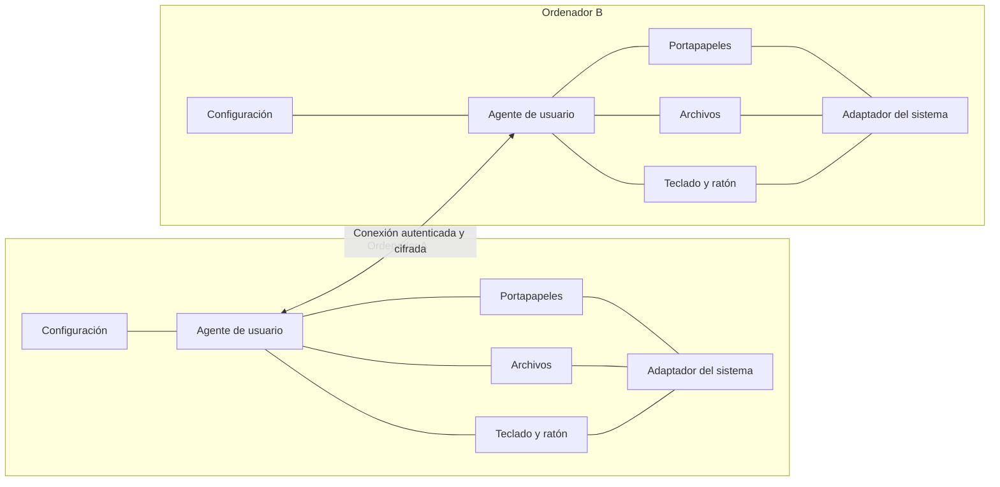

# OneInTwo — Estudio preliminar de requisitos y viabilidad

Fecha: 4 de noviembre de 2026.

Revisión de estado: 5 de noviembre de 2026.

Estado: propuesta de requisitos para orientar la aplicación integrada. Ya hay [tres prototipos independientes](experiments/README.md), con implementación y evidencia de compilación/pruebas aisladas de distinto alcance. No se han validado el escritorio real ni la comunicación entre dos equipos. Las capacidades descritas por una API o implementadas en un prototipo no demuestran disponibilidad en la instalación del usuario.

## 1. Objetivo y decisiones de partida

Desarrollar una aplicación original que permita trabajar con dos ordenadores conectados a una red local como un puesto de trabajo coordinado. Cada ordenador tendrá instalada la aplicación y conservará su propia pantalla.

### Requisitos confirmados por el usuario

- Compatibilidad con Windows y Linux; Ubuntu es la distribución objetivo inicial.
- Conexión entre dos ordenadores y configuración de qué funciones comparten.
- Copiar contenido al portapapeles en un equipo y pegarlo en el otro.
- Copiar archivos en un equipo y pegarlos en el otro.
- Compartir teclado y ratón, cambiando de ordenador al cruzar el borde de la pantalla.
- Implementación propia del producto y publicación bajo una licencia de código abierto.
- No utilizar una aplicación existente, como Deskflow, como motor del producto.

### Supuestos propuestos, pendientes de confirmar

- Una aplicación con módulos internos activables por separado y un instalador por plataforma.
- Funcionamiento sin cuentas, servidores externos ni acceso a Internet.
- Ubuntu con GNOME como entorno de investigación inicial; falta confirmar escritorio, versión y sesión Wayland/X11.
- Primera configuración: un monitor por equipo y un teclado/ratón de origen seleccionado. Cualquiera de los dos sistemas podrá ejercer ese papel.
- Sesiones de usuario iniciadas y desbloqueadas como alcance inicial.
- Uso de bibliotecas generales y API del sistema para interfaz, comunicación y criptografía, manteniendo propia la lógica del producto. El usuario todavía no ha confirmado expresamente este límite de «todo el código mío».

No se ha elegido lenguaje, biblioteca de interfaz, versión mínima de los sistemas ni licencia. Imágenes, texto enriquecido, varios monitores, reanudación de transferencias y control simultáneo desde ambos teclados son ampliaciones por decidir. El estudio no incorpora redirección USB general, vídeo remoto o sincronización permanente de carpetas.

## 2. Evaluación preliminar

| Área | Evaluación | Principal condicionante |
| --- | --- | --- |
| Conexión y vinculación | Viable con mecanismos habituales de red | Identidad de los equipos, permisos y cortafuegos |
| Transferencia explícita de archivos | Viable | Integridad, rutas, errores y límites de recursos |
| Portapapeles de texto | Viable en principio, condicionado en Wayland | Acceso en segundo plano y permisos del escritorio |
| Copiar/pegar archivos entre exploradores | Viabilidad pendiente de prototipo completo | Representación de archivos remotos y entrega de contenido al explorador |
| Teclado y ratón en Windows | Viable dentro de los límites de la sesión | Captura, inyección y aplicaciones con permisos elevados |
| Teclado y ratón en Ubuntu/Wayland | Viable si el entorno expone las capacidades necesarias | Captura en origen, entrada en destino y devolución del control |

El riesgo principal está en la integración con los escritorios. La primera inversión debe resolver esas incertidumbres, antes de desarrollar una interfaz completa o fijar fechas de entrega.

## 3. Conexión, vinculación y permisos

| ID | Requisito propuesto | Comprobación esperada |
| --- | --- | --- |
| CON-01 | Descubrir equipos disponibles en la red local y ofrecer conexión por dirección manual | Funcionar también cuando el descubrimiento automático esté bloqueado |
| CON-02 | Vincular equipos mediante confirmación en ambos extremos, asociada a sus identidades criptográficas | Un tercer equipo no puede hacerse pasar por uno ya vinculado |
| CON-03 | Recordar la vinculación y permitir revocarla | Un equipo revocado deja de poder usar cualquier función |
| CON-04 | Configurar envío y recepción de portapapeles y archivos, y permiso para controlar la entrada | Desactivar una función impide sus operaciones aunque la conexión siga abierta |
| CON-05 | Mostrar estados comprensibles: desconectado, vinculando, conectado, permiso pendiente o función no disponible | Los errores indican una acción posible |
| CON-06 | Reconectar tras suspensión, reinicio del proceso o cambio de dirección | No reproducir teclas antiguas ni operaciones ya terminadas |
| CON-07 | Negociar versión del protocolo y capacidades | Rechazar incompatibilidades y mostrar limitaciones sin fallos silenciosos |
| CON-08 | Resolver conexiones simultáneas iniciadas desde ambos equipos | Mantener una sola sesión lógica entre ellos |

Se propone evaluar mDNS para descubrimiento local, con conexión manual como alternativa. El descubrimiento solo anuncia disponibilidad; no establece confianza. Multicast DNS está definido para resolución en el enlace local, por lo que no se debe prometer descubrimiento a través de cualquier subred. [RFC 6762](https://www.rfc-editor.org/rfc/rfc6762).

La validación de red cubrirá Ethernet, Wi-Fi, cortafuegos, varias interfaces y cambios de dirección. El aislamiento de clientes de un punto de acceso puede impedir la comunicación: la aplicación debe distinguir «equipo no encontrado» de «equipo encontrado pero inaccesible» cuando disponga de evidencia.

## 4. Integración con Windows y Ubuntu

### Windows

- **Portapapeles:** notificaciones mediante `AddClipboardFormatListener` y lectura/escritura de formatos compatibles. Deben manejarse contención y datos que la aplicación de origen genere bajo demanda. [Uso del portapapeles de Windows](https://learn.microsoft.com/en-us/windows/win32/dataxchg/using-the-clipboard).
- **Captura de entrada:** evaluar los mecanismos `WH_KEYBOARD_LL` y `WH_MOUSE_LL`, que permiten observar y bloquear eventos. Sus callbacks necesitan procesamiento rápido; la red y el disco deben ejecutarse fuera de ellos. [Captura de teclado](https://learn.microsoft.com/en-us/windows/win32/winmsg/lowlevelkeyboardproc), [captura de ratón](https://learn.microsoft.com/en-us/windows/win32/winmsg/lowlevelmouseproc).
- **Entrada remota:** `SendInput` permite introducir eventos, pero está limitado por el nivel de integridad de las aplicaciones. Controlar ventanas elevadas requiere un análisis específico. [Documentación de SendInput](https://learn.microsoft.com/en-us/windows/win32/api/winuser/nf-winuser-sendinput).

Propuesta: ejecutar el agente en la sesión del usuario con permisos normales. Login, escritorio seguro, avisos de elevación y control de aplicaciones elevadas no formarán parte de la primera garantía de compatibilidad. No ejecutar toda la aplicación como administrador para ocultar estas limitaciones.

### Ubuntu con Wayland

La vía candidata para el ordenador de origen es `InputCapture`: autorización, zonas de pantalla, barreras en los bordes y conexión EIS. El compositor decide cuándo empieza y termina la captura; activarla no equivale a recibir inmediatamente eventos. Esto afecta tanto al cruce de pantalla como a cualquier atajo que pretendiera iniciar el control remoto. [Portal InputCapture](https://flatpak.github.io/xdg-desktop-portal/docs/doc-org.freedesktop.portal.InputCapture.html).

En el destino se evaluará `RemoteDesktop` para autorizar dispositivos y enviar entrada mediante EIS/libei. La captura de vídeo es una integración separada y no constituye una necesidad del producto. La persistencia de permisos depende del soporte y de la autorización concedida. [Portal RemoteDesktop](https://flatpak.github.io/xdg-desktop-portal/docs/doc-org.freedesktop.portal.RemoteDesktop.html).

libei comunica la aplicación con la implementación de entrada del escritorio. Su conexión local no sustituye el protocolo de red de OneInTwo. [Documentación de libei](https://libinput.pages.freedesktop.org/libei/).

Es necesario detectar capacidades y versiones en ejecución, tratar cancelaciones de permisos y probar ambos papeles: Ubuntu como origen y como destino. La existencia de estas interfaces en la documentación actual no fija una versión mínima de Ubuntu.

### Ubuntu con X11

Si se decide soportarlo, tendrá un adaptador específico. XTEST ofrece mecanismos para generar entrada sintética en X11; esa vía requiere pruebas propias y no demuestra compatibilidad con aplicaciones nativas Wayland. [Especificación de la biblioteca XTEST](https://www.x.org/releases/X11R7.6/doc/libXtst/xtestlib.pdf).

La matriz publicada deberá identificar versiones de Ubuntu, escritorio, sesión, explorador y capacidades verificadas. La etiqueta genérica «Linux compatible» sería insuficiente.

## 5. Portapapeles compartido

### Requisitos funcionales

| ID | Requisito propuesto |
| --- | --- |
| CLP-01 | Compartir inicialmente texto Unicode en ambas direcciones, incluyendo acentos, saltos de línea y emoji |
| CLP-02 | Funcionar con la ventana de configuración cerrada y sin necesidad de compartir teclado y ratón, si el entorno lo permite |
| CLP-03 | Detectar escrituras recibidas de OneInTwo para evitar reenvíos infinitos |
| CLP-04 | Definir un orden determinista para copias concurrentes, sin depender exclusivamente de los relojes de los equipos |
| CLP-05 | Aplicar límites de tamaño y rechazar formatos no soportados sin romper el portapapeles local |
| CLP-06 | Ofrecer pausa rápida; no conservar historial de contenidos por defecto |
| CLP-07 | Evitar que una reconexión reemplace el portapapeles local con una copia antigua sin una política explícita |

Cada cambio debe llevar identidad de origen, sesión y número de operación. Una escritura remota no debe tratarse como una nueva copia del usuario. La regla de resolución de concurrencia debe documentarse y probarse antes de implementar sincronización bidireccional.

### Incertidumbre crítica en Wayland

El portal `Clipboard` amplía sesiones de otros portales; no crea una sesión independiente. En sesiones `InputCapture`, el acceso al portapapeles solo está disponible mientras la captura está activa. Por tanto, esta vía por sí sola no garantiza sincronización continua con el ratón trabajando localmente. [Portal Clipboard](https://flatpak.github.io/xdg-desktop-portal/docs/doc-org.freedesktop.portal.Clipboard.html).

Debe probarse si el entorno objetivo permite una sesión autorizada adecuada para portapapeles independiente y qué permisos solicita. Si no es posible, habrá que evaluar una integración adicional específica del escritorio o una operación manual. Cualquiera de esas soluciones tiene que quedar visible como decisión de producto; no debe presentarse como cumplimiento automático de CLP-02.

Para imágenes y texto enriquecido habrá que acordar formatos interoperables, límites, conversión y comportamiento ante representaciones alternativas. Se proponen para una fase posterior al texto.

## 6. Archivos: transferencia e integración con copiar/pegar

### Dos problemas diferentes

1. **Transferir contenido:** leer archivos autorizados, enviarlos y escribirlos íntegramente en el destino.
2. **Integrarse con el explorador:** representar lo copiado y proporcionar el contenido cuando el usuario pega en una carpeta.

Un botón «Enviar» resuelve el primer problema, pero no completa la funcionalidad solicitada de copiar en un explorador y pegar en el otro.

### Requisitos de transferencia

| ID | Requisito propuesto |
| --- | --- |
| FIL-01 | Transferir archivos y árboles de carpetas en ambas direcciones, incluyendo archivos vacíos |
| FIL-02 | Mostrar progreso, destino, cancelación y errores por elemento |
| FIL-03 | Enviar contenido por bloques, sin cargar un archivo completo en memoria |
| FIL-04 | Validar tamaño e integridad antes de dar por terminado cada archivo |
| FIL-05 | Mantener archivos incompletos separados de los definitivos y publicarlos al terminar correctamente |
| FIL-06 | Resolver nombres repetidos sin sobrescribir silenciosamente |
| FIL-07 | Detectar falta de espacio, permisos insuficientes y desaparición o modificación del origen |
| FIL-08 | Limitar las solicitudes remotas a los elementos que el usuario haya ofrecido; no admitir lectura arbitraria de rutas |
| FIL-09 | Limitar cantidad de archivos, profundidad, tamaño de metadatos y espacio temporal |
| FIL-10 | Mantener disponibles el ratón, el teclado y la cancelación durante transferencias grandes |

La primera versión copiará y conservará los originales. Cortar y mover entre equipos queda pendiente por su riesgo de pérdida de datos. La reanudación tras interrupciones puede añadirse después; inicialmente debe ser posible reiniciar la transferencia con un error claro y sin declarar éxito parcial como completo.

Debe definirse el tratamiento de nombres inválidos en el destino, colisiones por mayúsculas/minúsculas, rutas largas, enlaces simbólicos y puntos de reanálisis. Propuesta inicial: archivos y carpetas ordinarios, rechazando tipos especiales con explicación. No se promete conservar permisos POSIX, ACL, flujos alternativos ni todos los metadatos entre sistemas.

### Integración en Windows

`CF_HDROP` representa rutas de archivos existentes. Para contenido virtual, Windows dispone de `CFSTR_FILEDESCRIPTOR` y `CFSTR_FILECONTENTS`, que pueden exponer datos mediante streams. Esta es una vía candidata para proporcionar archivos remotos bajo demanda, pero debe validarse con Explorer, carpetas y errores de red. [Formatos de archivos del portapapeles](https://learn.microsoft.com/en-us/windows/win32/shell/clipboard).

El prototipo debe estudiar objetos de datos OLE y transferencia asíncrona para que esperar a la red no congele el explorador. Las operaciones de copia y movimiento tienen semánticas diferentes que no deben confundirse. [Escenarios de transferencia del Shell](https://learn.microsoft.com/en-us/windows/win32/shell/datascenarios).

### Integración en Ubuntu

El formato de archivo del portapapeles depende del explorador. La documentación de Qt describe, entre otros, `x-special/gnome-copied-files` para Nautilus. Publicar una ruta de Windows como texto no crea un archivo accesible desde Ubuntu. [Notas sobre archivos y portapapeles](https://doc.qt.io/qt-6/qclipboard.html).

El portal `FileTransfer` sirve para hacer accesibles archivos entre aplicaciones locales, incluyendo aplicaciones aisladas. No implementa el traslado entre ordenadores; puede ser una pieza de la entrega local una vez que OneInTwo facilite el contenido. [Portal FileTransfer](https://flatpak.github.io/xdg-desktop-portal/docs/doc-org.freedesktop.portal.FileTransfer.html).

### Alternativas que debe comparar el prototipo

| Alternativa | Ventaja | Coste o límite |
| --- | --- | --- |
| Descargar a una caché local y publicar archivos ya disponibles | Simplifica el acceso del explorador | Consume espacio y puede transferir antes de que el usuario pegue; requiere indicar cuándo están listos |
| Proveedor de contenido bajo demanda | Se aproxima a transferir al pegar | Mayor integración por sistema y tratamiento de tiempos de espera |
| Acción explícita de pegar/recibir desde OneInTwo | Permite entregar pronto la transferencia | Cambia la experiencia; por sí sola no satisface el pegado nativo solicitado |

Recomendación: investigar primero las dos primeras opciones, con un archivo y una carpeta. No añadir un sistema de archivos virtual hasta demostrar que es necesario. La caché necesitará cuota, permisos privados y una política que no elimine archivos mientras el explorador aún pueda necesitarlos.

## 7. Teclado y ratón compartidos

### Modelo inicial

Se selecciona un equipo cuyos dispositivos físicos se compartirán. El destino activo alterna entre ambos ordenadores al cruzar los bordes configurados. El mismo programa debe permitir invertir el equipo de origen sin instalar una edición diferente.

Cruzar de vuelta a la pantalla inicial no exige cambiar el origen físico del teclado. Debe calcularse la salida del escritorio remoto y liberar la captura en el equipo de origen. La implementación exacta de esa detección y la posición de retorno forman parte del prototipo.

| ID | Requisito propuesto |
| --- | --- |
| INP-01 | Configurar qué borde conecta las pantallas y representar su posición relativa |
| INP-02 | Transferir movimiento, botones, rueda y pulsaciones/liberaciones de teclado |
| INP-03 | Evitar que la entrada dirigida al remoto actúe también sobre aplicaciones del origen |
| INP-04 | Gestionar modificadores, repetición de teclas y eventos de entrada sintetizados sin bucles |
| INP-05 | Recuperar control local mediante un gesto o atajo probado en la plataforma, y automáticamente al perder la conexión |
| INP-06 | Liberar teclas y botones remotos ante desconexión, cancelación, bloqueo o cierre de sesión |
| INP-07 | Evitar rebotes entre bordes y ajustar coordenadas a resolución y escalado |
| INP-08 | Definir qué sucede si se utiliza el teclado o ratón físico del equipo controlado |
| INP-09 | Rechazar eventos atrasados de una sesión anterior |

El receptor necesita su propio temporizador de pérdida de conexión para liberar teclas: no puede depender de recibir un último mensaje del emisor cuando se corta la red. El origen debe recuperar el control aunque el destino haya dejado de responder.

Se recomienda transmitir eventos de tecla, manteniendo una representación documentada y una conversión por plataforma. Debe elegirse si predomina la posición física o el significado del carácter. Las pruebas iniciales incluirán teclado español, `ñ`, acentos, AltGr, Ctrl, Alt, Shift y combinaciones mantenidas durante el cruce. Escribir texto Unicode no sustituye la transmisión de atajos.

La detección de monitores, escalado y cambios de disposición debe existir desde el diseño. La compatibilidad inicial puede limitarse expresamente a un monitor por equipo; varios monitores requerirán sus propias pruebas de bordes, zonas sin pantalla y conexiones/desconexiones de monitores.

## 8. Arquitectura propuesta

Una aplicación distribuida en dos instalaciones iguales, con un agente por sesión de usuario y una interfaz de configuración. Los módulos son divisiones de código; inicialmente no se propone convertirlos en servicios independientes.

El núcleo compartido contendrá vinculación, permisos, protocolo, transferencias y estado de la sesión. Los adaptadores concentrarán las diferencias de Windows, Wayland y, si se incluye, X11.

El protocolo deberá definir versión, tipo y longitud de mensaje, límites, capacidades, identificadores de operación, errores y cancelación. Los estados de entrada deberán distinguir control local, transición, control remoto y recuperación. No transmitir estructuras nativas de memoria directamente por la red.

Se propone empezar con conexiones fiables cifradas, separando el tráfico interactivo del contenido voluminoso. Cada canal adicional debe quedar autenticado y asociado a la sesión vinculada. Separar canales evita algunas colas compartidas, pero no elimina la saturación de la red: se necesita control de flujo y, si las mediciones lo exigen, limitar transferencias.

No se justifica introducir transporte no fiable, compresión general o descubrimiento entre subredes antes de medir una necesidad real.

## 9. Seguridad, privacidad y recuperación

Estos requisitos son parte del funcionamiento básico: se transportan contenido privado y acciones de teclado.

- Cifrar el tráfico mediante una implementación mantenida de TLS u otro mecanismo estándar evaluado. No diseñar primitivas criptográficas propias. TLS es una base de transporte, no una solución completa de vinculación. [Especificación TLS 1.3](https://www.rfc-editor.org/rfc/rfc8446).
- Verificar la identidad inicial mediante un mecanismo de comparación o autenticación revisado. Un nombre de equipo o un código enviado sin protección no bastan. Guardar la identidad aceptada y rechazar cambios inesperados.
- Aplicar permisos en el receptor de cada operación, no solo en la interfaz que la ofrece.
- Proteger las claves en almacenamiento local adecuado y no incluirlas en logs o informes.
- Mantener vinculación y reconexión separadas: un equipo desconocido no debe adquirir confianza al reaparecer en la red.
- No registrar contenido del portapapeles ni pulsaciones. Reducir metadatos de archivos en diagnóstico y permitir borrarlos.
- Validar rutas de destino, incluidos componentes que puedan redirigir fuera de la carpeta autorizada. Rechazar rutas absolutas, recorridos `..` y accesos fuera de los archivos ofrecidos.
- Imponer límites antes de reservar memoria, abrir archivos o crear árboles de carpetas.
- Suspender el control al bloquear la sesión; reanudar solo bajo la política y permisos definidos.
- Al revocar permisos, detener nuevas operaciones y cancelar las que correspondan. La revocación no puede borrar una copia que el otro usuario ya haya guardado.

No se promete detectar automáticamente todas las contraseñas o secretos copiados. La protección inicial será control explícito del usuario, pausa visible y ausencia de historial propio.

## 10. Requisitos no funcionales y distribución

| Área | Objetivo preliminar |
| --- | --- |
| Respuesta de entrada | Movimiento fluido; objetivo orientativo de latencia añadida p95 inferior a 50 ms en una LAN cableada de referencia, pendiente de validar |
| Portapapeles | Texto pequeño disponible en menos de un segundo en la red de referencia, sin solicitudes de permiso adicionales una vez autorizada la sesión cuando el sistema lo permita |
| Recuperación | Objetivo de devolver control y liberar estados en menos de dos segundos tras detectar pérdida de comunicación; temporizadores a ajustar en pruebas |
| Memoria | Uso acotado independiente del tamaño total del archivo; límites de metadatos explícitos |
| Reposo | Procesamiento por eventos y ausencia de sondeo intensivo; registrar consumo de CPU y memoria antes de fijar presupuestos |
| Accesibilidad | Configuración operable por teclado, mensajes legibles y estado que no dependa solo del color |
| Diagnóstico | Versiones y capacidades detectadas, fallos y métricas sin contenido privado |
| Mantenimiento | Compilación y pruebas repetibles en ambos sistemas; documentación de dependencias y versiones |

Los umbrales son propuestas, no resultados ni compromisos de rendimiento. La medición de latencia deberá definir sus extremos y usar relojes comparables o instrumentación externa; restar relojes no sincronizados de dos máquinas no constituye una medición válida.

Distribución propuesta: instalador de Windows y paquete nativo para las versiones de Ubuntu elegidas. Deben incluir instalación, actualización, desinstalación, inicio opcional al iniciar sesión y diagnóstico de cortafuegos. Una aplicación en segundo plano debe poder abrirse desde el lanzador aunque el escritorio no muestre un icono de bandeja.

Los permisos solicitados deben corresponder a las funciones activadas. El empaquetado aislado se evaluará después de validar el acceso necesario al escritorio y a los archivos. No basta con que la interfaz arranque para declarar que el paquete funciona.

## 11. Selección tecnológica y código propio

La primera decisión técnica es comprobar las API del sistema, no elegir una interfaz visual definitiva.

Como candidato inicial puede evaluarse C++ con Qt para reducir el número de lenguajes y disponer de una interfaz común. Qt documenta plataformas Windows y Linux, pero sus APIs generales de portapapeles no demuestran por sí solas que se cumplan los requisitos globales de Wayland. La elección de una versión concreta depende de los sistemas mínimos y de la política de dependencias. [Plataformas de Qt](https://doc.qt.io/qt-6/supported-platforms.html).

Cualquier alternativa deberá demostrar acceso a Win32/OLE, D-Bus y EIS, integración con los bucles de eventos y distribución en ambos sistemas. El resultado de los prototipos debe pesar más que la comodidad de construir pantallas.

La interpretación propuesta de código propio es:

- Implementar el protocolo de aplicación, los módulos, los adaptadores y la experiencia de usuario en el proyecto.
- No incorporar motores o código de otras aplicaciones de compartición.
- Permitir, si el usuario lo confirma, SDK, bibliotecas generales y componentes del sistema claramente identificados.
- Mantener procedencia, versión y licencia de cada dependencia utilizada.

Antes de publicar habrá que elegir la licencia del código original y revisar las condiciones de distribución de las dependencias seleccionadas. Este estudio no elige una licencia ni afirma que las dependencias pasen a ser código propio. También deberán existir instrucciones de compilación, contribución y comunicación de fallos.

## 12. Pruebas preliminares que desbloquean el desarrollo

La tabla siguiente define las preguntas de viabilidad. Los prototipos y sus comprobaciones aisladas ya existen; los inventarios y compilaciones registrados en cada informe no cierran las pruebas de escritorio o de dos equipos. Consultar los informes de [portapapeles](experiments/clipboard/RESULTS.md), [entrada](experiments/input/RESULTS.md) y [archivos](experiments/files/RESULTS.md) para el alcance exacto de la evidencia.

| Prueba | Evidencia necesaria | Decisión que desbloquea |
| --- | --- | --- |
| P0. Inventario del entorno | Versiones de Windows, Ubuntu, escritorio, sesión, portales y dispositivos | Matriz inicial y versiones mínimas candidatas |
| P1. Entrada en ambos sentidos | Windows controla Ubuntu y Ubuntu controla Windows; cruce y retorno con teclado/ratón propios | Viabilidad del motor de entrada original |
| P2. Portapapeles independiente | Copiar y pegar en ambos sentidos con configuración cerrada y captura de entrada inactiva | Cumplimiento o limitación explícita de CLP-02 |
| P3. Pegado nativo de archivos | Un archivo y una carpeta, de Explorer a Nautilus y de Nautilus a Explorer | Proveedor bajo demanda frente a caché y coste de integración |
| P4. Fallos durante el control | Cortar red, cerrar procesos y revocar permisos con una tecla o botón pulsado | Recuperación local y limpieza del receptor |
| P5. Transferencia concurrente | Copiar un archivo grande mientras se escribe y mueve el ratón | Límites, prioridad y transporte |

Cada resultado debe guardar entorno exacto, pasos, resultado observado y limitaciones. Si falla P2 o P3, hay que revisar la experiencia propuesta antes de comprometer la arquitectura.

### Criterios de aceptación de la primera versión completa

- Dos equipos se vinculan, reconectan y revocan sin permitir acceso a un tercero.
- El texto copiado en cualquiera llega al otro sin bucles, incluyendo Unicode y copias concurrentes.
- Los archivos se pegan en la carpeta elegida del otro explorador; tamaño y hash coinciden, y las carpetas conservan su estructura admitida.
- Cancelación, disco lleno, nombres incompatibles y colisiones no provocan sobrescrituras silenciosas ni falsos éxitos.
- El teclado y ratón cruzan y regresan; la entrada no se duplica y no quedan teclas pulsadas tras una desconexión.
- Una transferencia grande no inutiliza el control interactivo ni el botón de cancelar.
- Desactivar una función detiene su uso y mantiene operativas las demás dentro de las capacidades declaradas.
- Instalación y uso funcionan con los permisos documentados en equipos limpios de la matriz soportada.

La combinación obligatoria inicial es Windows–Ubuntu. Windows–Windows y Ubuntu–Ubuntu son extensiones razonables de la misma aplicación, pero necesitan pruebas propias antes de anunciar soporte. Las pruebas automatizadas del núcleo deben complementarse con equipos reales: una máquina virtual no reproduce todas las condiciones de entrada y escritorio.

## 13. Secuencia recomendada y esfuerzo relativo

| Etapa | Entregable | Complejidad relativa y dependencia |
| --- | --- | --- |
| 0. Viabilidad de escritorio | P0–P4 y decisión documentada sobre portapapeles y pegado | Alta incertidumbre; realizar antes del producto completo |
| 1. Base de comunicación | Vinculación, permisos, reconexión y diagnóstico mínimo | Media; necesaria para integrar módulos |
| 2. Portapapeles de texto | Sincronización bidireccional con política de concurrencia | Media/alta según el resultado de P2 |
| 3. Entrada compartida | Motor propio integrado, disposición básica y recuperación | Alta; depende de P1 y P4 |
| 4. Archivos | Transferencia robusta y pegado nativo | Alta; la integración depende de P3 |
| 5. Primera publicación | Instaladores, documentación, licencia y matriz verificada | Media/alta; requiere pruebas completas y P5 |

Las pruebas de viabilidad de la etapa 0 serán pequeñas y específicas; no exigen construir antes todo el protocolo de producción. Un prototipo que funcione con permisos o condiciones especiales no debe confundirse con una función terminada.

No hay base suficiente para una estimación fiable en semanas. Los principales factores son la versión real de Ubuntu, la posibilidad de acceso continuo al portapapeles y el mecanismo de pegado de archivos. Tras P0–P4 se podrá estimar cada módulo con mayor fundamento.

## 14. Decisiones pendientes

1. Versiones y arquitecturas de Windows y Ubuntu; escritorio y sesión de Ubuntu.
2. Alcance de «código propio» respecto a bibliotecas generales, SDK y criptografía.
3. Si ambos equipos deben poder aportar dispositivos durante la misma sesión o basta con seleccionar un origen.
4. Uno o varios monitores por equipo en la primera publicación.
5. Formatos iniciales de portapapeles y límites de tamaño.
6. Si se acepta caché previa para pegar archivos cuando la entrega bajo demanda resulte demasiado costosa.
7. Política de conflictos, temporales y transferencias interrumpidas.
8. Lenguaje, interfaz, versiones mínimas y licencia, una vez cerradas las restricciones anteriores.

El siguiente paso es completar las compilaciones Linux pendientes y ejecutar manualmente P1, P2 y P3 en las dos máquinas reales, incluyendo los casos de recuperación de P4. Los manuales de cada experimento describen los pasos. Los resultados decidirán qué experiencia se puede ofrecer y qué código conviene integrar; P5 se reserva a la integración posterior.
