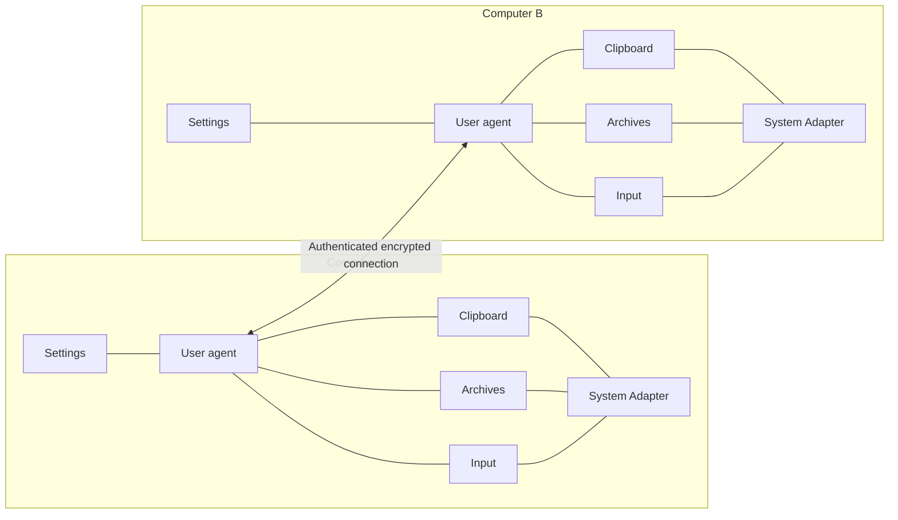

# OneInTwo — Preliminary study of requirements and feasibility

Date: November 4, 2026.

Status review: November 5, 2026.

Status: proposed requirements to guide the integrated application. There are already [three
independent prototypes](experiments/README.md), with implementation and evidence of
isolated builds and tests of different scope. The real desktop and communication between two
teams have not been validated. The capabilities described by a API or implemented in a prototype do
not demonstrate availability in the user installation.

## 1. Objective and starting decisions

Develop an original application that allows you to work with two computers connected to a local
network as a coordinated job. Each computer will have the application installed and keep its own
screen.

### User-confirmed requirements

- Windows and Linux compatibility; Ubuntu is the initial target distribution.
- Connection between two computers and configuration of what functions they share.
- Copy content to clipboard on one computer and paste it into the other.
- Copy files to one computer and paste them to the other.
- Share keyboard and mouse, changing computer when crossing the edge of the screen.
- Own implementation of the product and publication under an open source license.
- Do not use an existing application, such as Deskflow, as a product engine.

### Proposed, pending confirmation

- An application with separate enableable internal modules and a platform installer.
- Operation without accounts, external servers or Internet access.
- Ubuntu with GNOME as initial research environment; desktop, version and session Wayland/X11. is
  missing
- First configuration: one monitor per team and a keyboard and mouse of selected origin. Either system
  will be able to play that role.
- User sessions initiated and unlocked as initial scope.
- Use of general libraries and API of the system for interface, communication and cryptography,
  maintaining the product logic itself. The user has not yet expressly confirmed this limit of "all
  my code".

No language, interface library, minimal system version or license has been chosen. Images, rich
text, multiple monitors, resumption of transfers and simultaneous control from both keyboards are
extensions to be decided. The study does not incorporate general redirection USB, remote video or
permanent folder synchronization.

## 2. Preliminary assessment

| Area | Evaluation | Main conditioning factor |
| --- | --- | --- |
| Connection and linking | Viable with usual network mechanisms | Identity of equipment, permits and firewalls |
| Explicit file transfer | Viable | Integrity, routes, errors and resource limits |
| Text clipboards | Viable in principle, conditioned on Wayland | Background access and desktop permissions |
| Copiar/pegar files between explorers | Feasibility pending full prototype | Remote file representation and content delivery to the browser |
| Keyboard and mouse on Windows | Viable within session limits | Capture, injection and applications with high permissions |
| Keyboard and mouse on Ubuntu/Wayland | Viable if the environment displays the necessary capabilities | Catch at source, arrival at destination and return of control |

The main risk lies in integrating with desktops. The first investment must solve those
uncertainties, before developing a complete interface or setting delivery dates.

## 3. Connection, linking and permissions

| ID | Proposed requirement | Expected check |
| --- | --- | --- |
| CON-01 | Discover equipment available on the local network and offer manual direction connection | Also work when auto discovery is blocked |
| CON-02 | Linking equipment by confirmation at both ends, associated with their cryptographic identities | A third team can't pretend to be one already linked |
| CON-03 | Remembering the link and allowing it to be revoked | A revoked computer stops using any function |
| CON-04 | Configure submission and receipt of clipboards and files, and permission to control input | Deactivating a function prevents your operations even if the connection is still open |
| CON-05 | Show understandable states: disconnected, linking, connected, pending permission or function not available | Errors indicate a possible action |
| CON-06 | Reconnect after suspension, process restart or change of direction | Do not play old keys or finished operations |
| CON-07 | Negotiate protocol version and capabilities | Reject incompatibilities and show limitations without silent failures |
| CON-08 | Resolving simultaneous connections initiated from both teams | Keep a single logical session between them |

It is proposed to evaluate mDNS for local discovery, with manual connection as an alternative. The
discovery only announces availability; it does not establish confidence. Multicast DNS is defined
for resolution in the local link, so you should not promise discovery through any subnet. [RFC
6762](https://www.rfc-editor.org/rfc/rfc6762).

Network validation will cover Ethernet, Wi-Fi, firewall, various interfaces and directional changes.
Client isolation from an access point may prevent communication: the application must distinguish
"unfound equipment" from "found but inaccessible equipment" when evidence is available.

## 4. Integration with Windows and Ubuntu

### Windows

- **Paper clipboards:** `AddClipboardFormatListener` and lectura/escritura notifications of
  compatible formats. Containment and data must be handled that the source application generates on
  demand. [Windows clipboard
  use](https://learn.microsoft.com/en-us/windows/win32/dataxchg/using-the-clipboard).
- **Input capture:** evaluate mechanisms `WH_KEYBOARD_LL` and `WH_MOUSE_LL`Your callbacks need fast processing; the network and disk must run outside of them. [Keyboard screenshot](https://learn.microsoft.com/en-us/windows/win32/winmsg/lowlevelkeyboardproc), [mouse capture](https://learn.microsoft.com/en-us/windows/win32/winmsg/lowlevelmouseproc).
- **Remote entrance:** `SendInput` allows to enter events, but is limited by the level of integrity
  of applications. Controlling elevated windows requires a specific analysis. [SendInput
  Documentation](https://learn.microsoft.com/en-us/windows/win32/api/winuser/nf-winuser-sendinput).

Proposal: Run the agent in the user session with normal permissions. Login, secure desktop,
elevation notices and high application control will not be part of the first compatibility
guarantee. Do not run the entire application as an administrator to hide these limitations.

### Ubuntu con Wayland

The candidate path for the home computer is `InputCapture`: authorization, screen areas, border
barriers and EIS connection. The composer decides when the capture begins and ends; activating it
does not amount to receiving events immediately. This affects both the screen crossing and any
shortcut that the remote control intended to initiate. [Portal
InputCapture](https://flatpak.github.io/xdg-desktop-portal/docs/doc-org.freedesktop.portal.InputCapture.html).

At the destination, `RemoteDesktop` will be evaluated to authorize devices and send input via
EIS/libei. Video capture is a separate integration and does not constitute a product need.
Persistence of permissions depends on the support and authorization granted. [Portal
RemoteDesktop](https://flatpak.github.io/xdg-desktop-portal/docs/doc-org.freedesktop.portal.RemoteDesktop.html).

libei communicates the application with desktop input implementation. Your local connection does not replace the OneInTwo network protocol. [Libei Documentation](https://libinput.pages.freedesktop.org/libei/).

It is necessary to detect capabilities and running versions, treat permission cancellations and test
both roles: Ubuntu as source and as destination. The existence of these interfaces in the current
documentation does not set a minimum version of Ubuntu.

### Ubuntu con X11

If you decide to support it, you will have a specific adapter. XTEST offers mechanisms to generate
synthetic input in X11; that pathway requires own testing and does not demonstrate compatibility
with native Wayland applications. [Lebrary
spec.XTEST](https://www.x.org/releases/X11R7.6/doc/libXtst/xtestlib.pdf).

The published matrix should identify versions of Ubuntu, desktop, session, browser and verified
capabilities. The generic label "Linux compatible" would be insufficient.

## 5. Shared clipboards

### Functional requirements

| ID | Proposed requirement |
| --- | --- |
| CLP-01 | Initially share Unicode text in both directions, including accents, line breaks and emoji |
| CLP-02 | Run with closed configuration window and no need to share keyboard and mouse, if the environment allows |
| CLP-03 | Detect received scriptures from OneInTwo to avoid infinite forwardings |
| CLP-04 | Define a deterministic order for concurrent copies, without relying exclusively on equipment clocks |
| CLP-05 | Apply size limits and reject unsupported formats without breaking the local clipboard |
| CLP-06 | Offer quick pause; do not save default content history |
| CLP-07 | Prevent a reconnection from replacing the local clipboard with an old copy without explicit policy |

Each change must bear identity of origin, session and number of operation. A remote writing should
not be treated as a new user copy. The concurrent resolution rule must be documented and tested
before implementing bidirectional synchronization.

### Critical uncertainty in Wayland

The `Clipboard` portal expands sessions of other portals; it does not create an independent session.
In `InputCapture` sessions, access to the clipboard is only available while the capture is active.
Therefore, this track alone does not guarantee continuous synchronization with the mouse working
locally. [Portal
Clipboard](https://flatpak.github.io/xdg-desktop-portal/docs/doc-org.freedesktop.portal.Clipboard.html).

It should be proven whether the target environment allows an approved session suitable for
independent clipboards and what permissions you request. If not possible, additional
desktop-specific integration or manual operation will have to be evaluated. Any of these solutions
must be visible as a product decision; it should not be presented as automatic compliance of CLP-02.

For images and enriched text, interoperable formats, limits, conversion and behavior to alternative
representations will have to be agreed. They are proposed for a post-text phase.

## 6. Archives: transfer and integration with copiar/pegar

### Two different problems

1. **Transfer content:** read authorized files, send them and write them in full at the destination.
2. **Integrate with the browser:** represent the copied and provide the content when the user pastes
   into a folder.

One "Send" button solves the first problem, but does not complete the requested functionality of
copying to one browser and pasting to the other.

### Transfer requirements

| ID | Proposed requirement |
| --- | --- |
| FIL-01 | Transfer files and folder trees in both directions, including empty files |
| FIL-02 | Show progress, destination, cancellation and errors per item |
| FIL-03 | Send content by blocks, without loading a complete file into memory |
| FIL-04 | Validate size and integrity before terminating each file |
| FIL-05 | Keep incomplete files separated from the final ones and publish them when finished correctly |
| FIL-06 | Resolve repeated names without overwriting quietly |
| FIL-07 | Detect lack of space, insufficient permits and disappearance or modification of origin |
| FIL-08 | Limit remote requests to items offered by the user; not allow arbitrary path reading |
| FIL-09 | Limit file quantity, depth, metadata size and time space |
| FIL-10 | Keep your mouse, keyboard and cancellation available during large transfers |

The first version will copy and retain the originals. Cutting and moving between computers is
pending due to their risk of data loss. Resumption after interruptions can be added later; initially
it should be possible to restart the transfer with a clear error and without declaring partial
success as complete.

The treatment of invalid names at destination, collisions by letter case, long routes,
symbolic links and reanalysis points should be defined. Initial proposal: ordinary files and
folders, rejecting special types with explanation. It is not promised to retain POSIX, ACL,
alternative flows or all metadata between systems.

### Integration in Windows

`CF_HDROP` represents existing file paths. For virtual content, Windows has `CFSTR_FILEDESCRIPTOR`
and `CFSTR_FILECONTENTS`, which can display data via streams. This is a candidate way to provide
remote files on demand, but must be validated with Explorer, folders and network errors. [Formats of
clipboard files](https://learn.microsoft.com/en-us/windows/win32/shell/clipboard).

The prototype should study OLE data objects and asynchronous transfer so that waiting for the
network does not freeze the browser. Copy and motion operations have different semantics that should
not be confused. [Shell transfer
scenarios](https://learn.microsoft.com/en-us/windows/win32/shell/datascenarios).

### Integration in Ubuntu

The clipboard file format depends on the browser. Qt documentation describes, among others,
`x-special/gnome-copied-files` for Nautilus. Publishing a Windows path as text does not create a
file accessible from Ubuntu. [Notes on files and
clipboards](https://doc.qt.io/qt-6/qclipboard.html).

The `FileTransfer` portal serves to make files accessible between local applications, including
isolated applications. It does not implement the transfer between computers; it can be a piece of
local delivery once OneInTwo facilitates the content. [Portal
FileTransfer](https://flatpak.github.io/xdg-desktop-portal/docs/doc-org.freedesktop.portal.FileTransfer.html).

### Alternatives to compare prototype

| Alternativa | Ventaja | Cost or limit |
| --- | --- | --- |
| Download to a local cache and publish files already available | Simplify browser access | It takes up space and can transfer before the user pastes; it requires indicating when they are ready |
| On-demand content provider | Approaches transfer when pasting | Increased integration by system and treatment of waiting times |
| Explicit action of pegar/recibir from OneInTwo | Allows the transfer to be delivered soon | Change the experience; by itself it does not satisfy the requested native glue |

Recommendation: first investigate the first two options, with a file and a folder. Do not add a
virtual file system until you prove it is necessary. The cache will need quota, private permissions
and a policy that does not delete files while the browser may still need them.

## 7. Shared keyboard and mouse

### Initial model

A computer whose physical devices will be shared is selected. The active destination alternates
between the two computers when crossing the configured edges. The same program should allow the
original computer to be reversed without installing a different edition.

Crossing back to the initial screen does not require changing the physical origin of the keyboard.
The output of the remote desktop must be calculated and the capture released on the source computer.
The exact implementation of that detection and the return position are part of the prototype.

| ID | Proposed requirement |
| --- | --- |
| INP-01 | Configure which edge connects screens and represents their relative position |
| INP-02 | Transfer movement, buttons, wheel and pulsaciones/liberaciones keyboard |
| INP-03 | Prevent remote entry from also acting on source applications |
| INP-04 | Manage unlooped modifiers, repeat keys, and input events |
| INP-05 | Recover local control by a gesture or shortcut tested on the platform, and automatically when you lose connection |
| INP-06 | Release remote keys and buttons to disconnect, cancel, lock or close session |
| INP-07 | Avoid rebounds between edges and adjust coordinates to resolution and scaling |
| INP-08 | Define what happens if the physical keyboard or mouse of the controlled computer is used |
| INP-09 | Reject events late from previous session |

The receiver needs its own connection loss timer to release keys: it cannot depend on receiving a
last message from the sender when the network is cut. The source must recover control even if the
destination has stopped responding.

It is recommended to transmit key events, maintaining a documented representation and a platform
conversion. It should be chosen whether the physical position or the meaning of the character
predominates. Initial tests will include Spanish keyboard, `ñ`, accents, AltGr, Ctrl, Alt, Shift and
combinations maintained during the crossing. Writing Unicode text does not replace the shortcut
transmission.

Monitor detection, scaling and layout changes must exist from the design. Initial compatibility can
be explicitly limited to one monitor per computer; several monitors will require their own edge
tests, no-screen zones and conexiones/desconexiones monitors.

## 8. Proposed architecture

An application distributed in two equal installations, with one agent per user session and a
configuration interface. Modules are code divisions; initially it is not proposed to convert them
into independent services.

The shared kernel will contain linking, permissions, protocol, transfers, and session status.
Adapters will concentrate the differences of Windows, Wayland and, if included, X11.

The protocol must define version, type and length of message, limits, capabilities, operating
identifiers, errors and cancellation. Input states must distinguish local control, transition,
remote control and recovery. Do not transmit native memory structures directly through the network.

It is proposed to start with reliable encrypted connections, separating interactive traffic from
bulky content. Each additional channel should be authenticated and associated with the linked
session. Separating channels avoids some shared queues, but does not eliminate network saturation:
flow control is needed and, if measurements require, limiting transfers.

It is not justified to introduce unreliable transport, general compression or discovery between
subnets before measuring a real need.

## 9. Security, privacy and recovery

These requirements are part of the basic operation: private content and keyboard actions are
transported.

- Encrypt traffic using a maintained implementation of TLS or other standard mechanism evaluated. Do
  not design your own cryptographic primitives. TLS is a transport base, not a complete linking
  solution. [Specification TLS 1.3](https://www.rfc-editor.org/rfc/rfc8446).
- Checking the initial identity using a revised comparison or authentication mechanism. A computer
  name or code sent without protection is not enough. Save the accepted identity and reject
  unexpected changes.
- Apply permissions to the receiver of each operation, not just on the interface that offers it.
- Protect keys in suitable local storage and do not include them in logs or reports.
- Keeping connection and reconnection separate: an unknown computer should not gain confidence by
  re-appearing on the network.
- Do not record clipboard content or presses. Reduce metadata of files in diagnosis and allow them
  to be deleted.
- Validate destination routes, including components that can be redirected out of the authorized
  folder. Reject absolute routes, `..` routes and accesses outside the files offered.
- Impose limits before booking memory, opening files, or creating folder trees.
- Suspend control by blocking the session; resume only under defined policy and permissions.
- By revoking permissions, stopping new operations and canceling the corresponding ones. The
  revocation cannot erase a copy that the other user has already saved.

You do not promise to automatically detect all passwords or copied secrets. Initial protection will
be explicit user control, visible pause and absence of your own history.

## 10. Non-functional requirements and distribution

| Area | Preliminary objective |
| --- | --- |
| Input Response | Fluid movement; orientation lens of latency added p95 less than 50 ms in a LAN reference cable, pending validation |
| Clipboard | Small text available in less than one second on the reference network, without additional permission requests once the session is authorized when the system allows |
| Recovery | Objective to return control and release states in less than two seconds after detecting loss of communication; timers to adjust in tests |
| Memoria | Separately bounded use of the total file size; explicit metadata limits |
| Reposo | Event processing and absence of intensive surveying; recording CPU consumption and memory before setting budgets |
| Accesibilidad | Keyboard operable configuration, readable messages, and color-dependent status |
| Diagnosis | Detected versions and capabilities, faults and metrics without private content |
| Mantenimiento | Compiling and repeatable testing on both systems; documentation of dependencies and versions |

The thresholds are proposed, not results or performance commitments. The latency measurement must
define its ends and use comparable clocks or external instrumentation; subtracting unsynchronised
clocks from two machines does not constitute a valid measurement.

Proposed distribution: Windows installer and native package for selected Ubuntu versions. They
should include installation, update, uninstallation, optional login when logging in and firewall
diagnosis. A background application should be able to open from the launcher even if the desktop
does not display a tray icon.

The requested permissions must correspond to the activated functions. The isolated packaging will be
evaluated after validating the necessary access to the desktop and files. It is not enough for the
interface to boot to declare that the package works.

## 11. Technology selection and own code

The first technical decision is to check the API of the system, not to choose a definitive visual
interface.

As an initial candidate, C++ can be evaluated with Qt to reduce the number of languages and have a
common interface. Qt documents Windows and Linux platforms, but its general clipboard APIs alone do
not demonstrate that Wayland’s global requirements are met. Choosing a specific version depends on
the minimum systems and dependencies policy. [Qt
Platforms](https://doc.qt.io/qt-6/supported-platforms.html).

Any alternative must demonstrate access to Win32/OLE, D-Bus and EIS, integration with the event
loops and distribution in both systems. The result of the prototypes must weigh more than the
comfort of building screens.

The proposed interpretation of own code is:

- Implement the application protocol, modules, adapters and user experience in the project.
- Do not incorporate engines or code from other sharing applications.
- Allow, if confirmed by the user, SDK general libraries and clearly identified system components.
- Maintain provenance, version and license of each unit used.

Before publishing, you have to choose the license of the original code and review the distribution
conditions of the selected dependencies. This study does not choose a license or state that
dependencies become your own code. There must also be instructions for compiling, contributing and
communicating bugs.

## 12. Preliminary evidence that unlocks development

The following table defines the feasibility questions. Prototypes and their isolated checks already exist; inventories and compilations recorded in each report do not close the desktop or two-team tests.(experiments/clipboard/RESULTS.md), [entry](experiments/input/RESULTS.md) and [archives](experiments/files/RESULTS.md) for the exact scope of the evidence.

| Test | Evidence required | Decision Unlocking |
| --- | --- | --- |
| P0. Inventory of environment | Windows versions, Ubuntu, desktop, session, portals and devices | Initial matrix and minimum candidate versions |
| P1. Entry into both directions | Windows controls Ubuntu and Ubuntu controls Windows; crossing and return with keyboard and mouse of its own | Feasibility of the original input engine |
| P2. Clipboard independiente | Copy and paste in both directions with closed configuration and inactive input capture | Explicit compliance or limitation of CLP-02 |
| P3. Native file pasting | A file and folder, from Explorer to Nautilus and from Nautilus to Explorer | Supplier on demand versus cache and integration cost |
| P4. Failures during control | Cut network, close processes and revoke permissions with a clicked key or button | Local recovery and cleaning of the receiver |
| P5. Concurrent transfer | Copy a large file while typing and moving the mouse | Limits, priority and transport |

Each result must save exact environment, steps, observed result and limitations. If P2 or P3 fails,
the proposed experience must be reviewed before compromising the architecture.

### Acceptance criteria for the first full version

- Two teams link, reconnect and revoke without allowing access to a third party.
- Text copied into anyone reaches the other without loops, including Unicode and concurrent copies.
- Files are pasted into the folder chosen from the other browser; size and hash match, and folders
  retain their supported structure.
- Cancellation, full disk, incompatible names and collisions do not cause silent overwriting or
  false successes.
- The keyboard and mouse cross and return; the input is not duplicated and no keys are pressed after
  a disconnection.
- A large transfer does not disable the interactive control or the cancel button.
- Deactivating one function stops its use and keeps the others operational within declared
  capabilities.
- Installation and use work with documented permissions on clean computers in the supported array.

The initial mandatory combination is Windows–Ubuntu. Windows–Windows and Ubuntu–Ubungu are
reasonable extensions of the same application, but need own testing before announcing support.
Automated core testing should be complemented by real equipment: a virtual machine does not
reproduce all entry and desktop conditions.

## 13. Recommended sequence and relative effort

| Etapa | Entregable | Relative complexity and dependence |
| --- | --- | --- |
| 0. Desktop Feasibility | P0–P4 and documented decision on clipboard and pasted | High uncertainty; perform before full product |
| 1. Basis of communication | Linking, permissions, reconnection and minimal diagnosis | Medium; required to integrate modules |
| 2. Text clipboards | Two-way synchronization with competition policy | Media/alta as a result of P2 |
| 3. Shared entry | Integrated own engine, basic layout and recovery | High; depends on P1 and P4 |
| 4. Archives | Robust transfer and native glue | High; integration depends on P3 |
| 5. First publication | Installers, Documentation, License and Verified Matrix | Media/alta; requires complete testing and P5 |

Feasibility tests for stage 0 will be small and specific; they do not require the entire production
protocol to be built first. A prototype that works with special permits or conditions should not be
confused with a finished function.

There is not enough basis for a reliable estimate in weeks. The main factors are the actual version
of Ubuntu, the possibility of continuous access to the clipboard and the file pasting mechanism.
After P0–P4 each module can be estimated with greater foundation.

## 14. Pending decisions

1. Windows and Ubuntu desktop and session versions and architectures.
2. Scope of ‘own code’ for general libraries, SDK and cryptography.
3. If both teams must be able to provide devices during the same session or simply select a source.
4. One or more monitors per team in the first publication.
5. Initial clipboard formats and size limits.
6. If you accept prior cache to paste files when delivery on demand is too expensive.
7. Conflict, temporary and interrupted transfer policy.
8. Language, interface, minimum versions and license, once the above restrictions are closed.

The next step is to complete the pending Linux compilations and manually run P1, P2 and P3 on the
two real machines, including P4 recovery cases. The manuals for each experiment describe the steps.
The results will decide what experience can be offered and what code to integrate; P5 is reserved
for subsequent integration.
